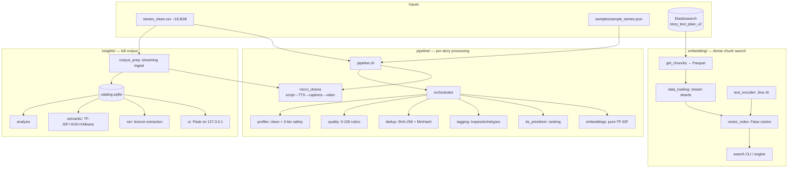
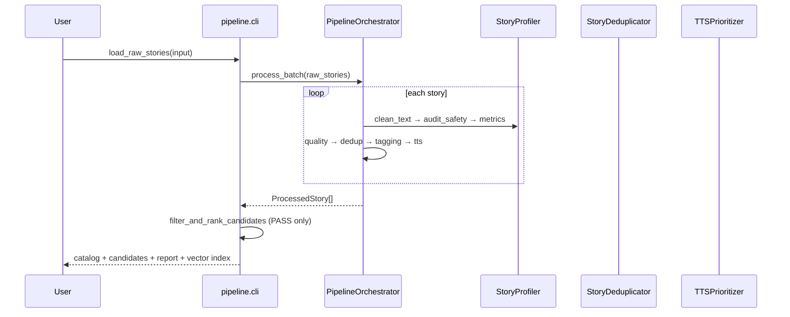
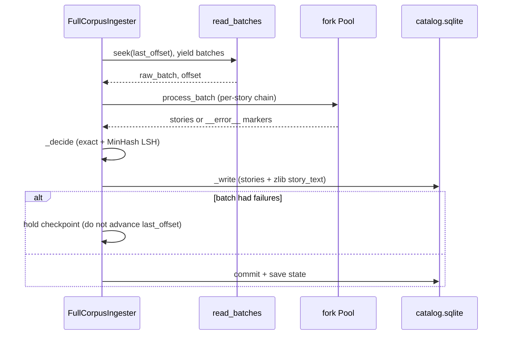

## Architecture Overview

### System Summary

**Story Analysis** is a batch-processing monorepo, not a deployed web service. It turns an
internal reference corpus of narrative fiction (the ~300K-row _Nifty Archive_ export,
`stories_clean.csv`, ~18.8 GB) into three deliverables:

1. **A TTS-ready audio catalogue**—cleaned, safety-screened, quality-tiered, deduplicated
   stories ranked for text-to-speech production.
2. **An internal insight platform**—a local Flask UI over a SQLite catalogue with
   statistical dashboards, semantic search, NER combination search, and cheap local TTS
   audition.
3. **Social micro-drama videos**—9:16 vertical videos adapted from selected stories with
   neural TTS, kinetic captions, and a ffmpeg compositor.

The corpus has unknown copyright and is **internal-only**: it is never shipped, and data
artifacts (`data/`, `*.sqlite*`, `*.parquet`) are gitignored.

**Tech Stack**

| Layer | Technology |
| --- | --- |
| Language | Python **3.14+**, `from __future__ import annotations`, PEP 585/604 annotations |
| Numerics | `numpy` (CUDA build), `pandas`, `pyarrow` (Parquet) |
| Dense vectors | `faiss-gpu-cuvs` (`IndexFlatIP`), `torch`, `transformers`, `peft` |
| Classic ML | `scikit-learn` (`TfidfVectorizer`, `TruncatedSVD`, `MiniBatchKMeans`) |
| Storage | SQLite catalogue (WAL), zlib blobs, Parquet shards, JSON/npz artifacts |
| External | Elasticsearch (`story_text_plain_v2`), `unstructured-transform-client` |
| Audio/video | `edge-tts`, `ffmpeg`/`ffprobe`, `pillow`, DejaVu fonts |
| Web | `flask` (local only, `127.0.0.1`) |
| Env / packaging | **Flox** (`.flox/env/manifest.toml`), `uv` (`uv.lock`), `bun` (stub `package.json`) |
| Quality | `pytest` (103 tests), `ruff` |

### High-Level Architecture



### Repository Structure

```
story-analysis/
├── pipeline/                    # Per-story processing (JGF-4)
│   ├── schemas.py               # Dataclasses: RawStory, ProcessedStory, enums
│   ├── profiler.py              # Cleaning + module-scope safety regexes
│   ├── quality.py               # 5-dimension 0-100 rubric, Tier 1-4
│   ├── dedup.py                 # Exact SHA-256 + MinHash/Jaccard clustering
│   ├── tagging.py               # Trope/archetype/setting/POV/heat taxonomy
│   ├── tts_prioritizer.py       # Candidate ranking, SSML chunking, voice profile
│   ├── embeddings.py            # Pure-Python TF-IDF vector index (no LLM)
│   ├── orchestrator.py          # Wires the per-story chain; audit report
│   ├── cli.py                   # Batch CLI → JSONL/JSON outputs
│   └── micro_drama/             # Story → social video (README: undocumented)
│       ├── models.py            # MicroDramaScript, DialogueLine, SubtitleCue
│       ├── script_adapter.py    # 30-45s script + SFW compliance filter
│       ├── audio_engine.py      # edge-tts multi-voice + procedural drone
│       ├── caption_styler.py    # ASS/SRT with mobile safe zones
│       ├── video_compositor.py  # ffmpeg 9:16 + burn-in subs
│       └── pipeline_runner.py   # End-to-end + batch manifest
├── insights/                    # Full-corpus platform (JGF-12)
│   ├── corpus_prep.py           # Streaming CSV → SQLite, MinHash LSH, checkpoint
│   ├── analysis.py              # Dashboards/trends over the catalogue
│   ├── semantic.py              # TF-IDF + SVD + KMeans topic clusters
│   ├── ner.py                   # Deterministic lexicon NER + combo search
│   ├── tts_audition.py          # piper / espeak-ng local audition
│   └── ui.py                    # Flask UI (dashboard/search/combo/story)
├── embedding/                   # Dense chunk search (Faiss + Jina)
│   ├── export_utils.py          # Atomic staged publish + crash recovery
│   ├── get_chuncks.py           # ES → data/chunks/*.parquet (1024-d float32)
│   ├── get_vectors.py           # ES → data/vectors/*.parquet (float16, alt schema)
│   ├── data_loading.py          # Streaming Parquet/JSONL readers
│   ├── vector_index.py          # ChunkVectorIndex (IndexFlatIP cosine)
│   ├── text_encoder.py          # JinaTextEncoder (query/document prompts)
│   ├── search_engine.py         # ChunkSearchEngine (query → hits)
│   └── search.py                # CLI entrypoint + re-export facade
├── parse/parse.py               # unstructured Transform API client (not wired in)
├── scripts/
│   ├── ingest.sh                # pipefail wrapper + zero-rows guard
│   ├── measure_safety.py        # Safety verdict distribution harness
│   └── elasticsearch/decompress_reindex.py  # base64+zlib → plaintext reindex
├── tests/                       # 4 modules, 103 tests
├── samples/                     # sample_stories.json, 200-chunk JSONL sample
├── docs/                        # Specifications + this architecture doc
├── analysis_outputs/            # Vector-search review (SUMMARY/RISKS/status)
├── types/                       # Type stubs mirroring the source tree
└── big-query/                   # Data-exploration notebook
```

### Three Separate Embedding Systems

A frequent source of confusion: there are **three** unrelated vector paths. They are not
interchangeable.

| System | Module | Algorithm | Scope | Used by |
| --- | --- | --- | --- | --- |
| Story-level TF-IDF | `pipeline/embeddings.py` | Pure-Python TF-IDF + cosine (`PurePythonVectorizer`) | Whole story text | `pipeline.cli` (`vector_index.json`) |
| Corpus LSA clusters | `insights/semantic.py` | sklearn TF-IDF → SVD (192-d) → MiniBatchKMeans | Title + preview of Tier 1/2 | `insights.ui` search/clusters |
| Dense chunk vectors | `embedding/` | Jina v5 (1024-d) → Faiss `IndexFlatIP` | Chunk-level, from ES export | `python -m embedding.search` |

`embedding/get_chuncks.py` writes `data/chunks/` (schema `id, chunk_index, …,
embedding float32[1024]`). `embedding/get_vectors.py` writes `data/vectors/` with a
_different_ schema (`doc_id, record_id, chunk_index, embedding float16[1024]`) and is **not**
read by `embedding.search`.

### Core Modules

#### `pipeline/`—per-story processing chain

`PipelineOrchestrator.process_raw_story` runs each story through, in order:

1. `StoryProfiler.clean_text`—HTML/entity decode, NFKC, mojibake fixes, Usenet header and
   anonymiser-footer stripping, paragraph normalisation.
2. `StoryProfiler.audit_safety`—three preemptive verdicts (below).
3. `StoryProfiler.calculate_text_metrics`—word/char/sentence/paragraph counts, dialogue
   ratio, TTR, sensory and explicit density, estimated audio minutes.
4. `StoryQualityScorer.evaluate`—five weighted dimensions summing to 0–100 → `QualityTier`.
5. `StoryDeduplicator.process_story`—exact normalised SHA-256, then MinHash + Jaccard.
6. `StoryTaxonomyTagger.tag_story`—tropes, archetypes, setting, heat, POV, pacing,
   duration tier.
7. `TTSPrioritizer.generate_tts_metadata`—suitability, voice profile, SSML segments.

**Safety verdicts (in precedence order).** Every consumer gates on `== PASS`:

| Verdict | Trigger | Downstream |
| --- | --- | --- |
| `FAIL_UNDERAGE_RISK` | Age/CSAM indicator or underage tag—**fail-closed** | Quarantined |
| `FAIL_EXTREME_VIOLENCE` | necrophilia, snuff, bestiality, zoophilia | Quarantined |
| `FLAGGED_MANUAL_REVIEW` | abuse, rape, murder, assault, suicide | Quarantined but triageable |
| `PASS` | none | Eligible for TTS/embeddings/UI |

#### `pipeline/micro_drama/`—social video generator

`MicroDramaPipeline.process_story` adapts a story into a 28–35s script
(`ScriptAdapter`, with an SFW compliance filter + sensory substitutions), synthesises
multi-voice audio with `edge-tts` plus a procedural FFmpeg drone, builds ASS/SRT captions
(`CaptionStyler`, 1080×1920 with safe margins), and composites a 9:16 H.264 video
(`VideoCompositor`). `process_batch` writes a `<batch>_manifest.json` marked
`ready_for_user_approval`. Requires `ffmpeg`, `ffprobe`, and the DejaVu fonts at
`/usr/share/fonts/truetype/dejavu/`.

#### `insights/`—full-corpus platform

`insights.corpus_prep.FullCorpusIngester` streams the CSV with a quote-balanced reader and a
byte-offset checkpoint (`meta.ingest_state`), runs `process_rows` across a `fork` pool, then
applies global exact + banded MinHash LSH dedup (128 permutations, 4-row bands, 0.80
threshold) and writes `catalog.sqlite` (`stories`, `story_text`, `meta`). Full text is stored
zlib-compressed **only** for canonical, safety-passing Tier 1/2 stories ≥150 words.

Downstream readers: `analysis.py` (dashboards), `semantic.py` (TF-IDF+SVD+KMeans →
`vectors.npz`, `clusters.json`, `pipeline.pkl`), `ner.py` (lexicon entities →
`entity_mentions`), and `ui.py` (Flask: `/`, `/search`, `/combo`, `/story/<id>`,
`/api/health`).

#### `embedding/`—dense chunk search

`get_chuncks.py` scans ES in 4 slices via `ProcessPoolExecutor` and writes one Parquet shard
per slice **into a staging directory**, publishing only after all slices finish
(`export_utils.publish_directory`). A crashed promotion is recovered on the next run
(`recover_published_directory`). At query time `data_loading.iter_embedding_batches` streams
shards, `vector_index.ChunkVectorIndex` L2-normalises into `faiss.IndexFlatIP`,
`text_encoder.JinaTextEncoder` encodes queries (Jina v5 `query`/`document` prompts), and
`search_engine.ChunkSearchEngine` returns ranked `(story_id, chunk_index, score)`.

#### `parse/parse.py`—documents

Thin wrapper over `unstructured-transform-client` (parse/extract/poll). **Not wired into the
pipeline**; tracked as a coverage gap (STO-1250).

### Entry Points

| Command | Module | Produces |
| --- | --- | --- |
| `python -m pipeline.cli -i samples/sample_stories.json -o data/output` | `pipeline.cli` | `cleaned_catalog.jsonl`, `tts_priority_candidates.json`, `audit_summary.json`, `vector_index.json`, optional `tts_chunks/` |
| `python -m insights.corpus_prep --csv … --db data/catalog.sqlite` | `insights.corpus_prep` | `catalog.sqlite` + `.ingest_result.json` |
| `scripts/ingest.sh --csv … --db …` | shell wrapper | Same, with `pipefail` + zero-rows guard + timestamped log |
| `python -m insights.analysis --db … --out-dir insights_output/analysis` | `insights.analysis` | `analysis.json` |
| `python -m insights.semantic --db … --out-dir insights_output` | `insights.semantic` | `vectors.npz`, `clusters.json`, **`pipeline.pkl`** |
| `python -m insights.ner --db …` | `insights.ner` | `entity_mentions` table |
| `python -m insights.ui --db … --out-dir insights_output` | `insights.ui` | Flask UI on `127.0.0.1:8765` |
| `python -m embedding.get_chuncks` | `embedding.get_chuncks` | `data/chunks/*.parquet` (needs `ES_URL`, `ES_API_KEY`) |
| `python -m embedding.search "query"` / `--sample` | `embedding.search` | Ranked chunk hits |
| `python -m pipeline.micro_drama.pipeline_runner` | `pipeline.micro_drama` | `_micro_drama.mp4`, `.ass`, `.srt`, `_script.json` |
| `python scripts/measure_safety.py --csv … --limit 5000` | `scripts.measure_safety` | Safety verdict distribution |
| `python scripts/elasticsearch/decompress_reindex.py` | reindex script | `story_text_plain` ES index |

### Data Flows

#### Batch catalogue (`pipeline.cli`)



#### Full-corpus ingest (`insights.corpus_prep`)



### Data Model

`pipeline/schemas.py` defines `RawStory` → `ProcessedStory`, with enums `SafetyVerdict`,
`QualityTier`, `HeatLevel`, `AudioDurationTier`, and nested `SafetyAudit`, `QualityBreakdown`,
`StoryTaxonomy`, `TTSMetadata`.

`insights/corpus_prep.SCHEMA` defines the SQLite catalogue:

- `stories`—one row per source record (canonical **or** duplicate): metadata, metrics,
  safety/quality/taxonomy columns, `exact_hash`, `sig` (MinHash BLOB), `is_canonical`,
  `dup_of`, `preview`.
- `story_text`—`id → zlib-compressed full_text` (canonical, PASS, Tier 1/2 only).
- `meta`—`ingest_state` (rows_done, last_offset, error_types).

### Key Invariants and Conventions

- **Regexes at module scope.** All cleaning/safety patterns live in `pipeline/profiler.py`
  module scope and are registered in `REGEX_PATTERNS`; `validate_patterns()` runs at import.
  `tests/test_insights.py` has an AST check forbidding `re.compile()` inside a function. A
  pattern compiled in a function raises per row, is swallowed by `process_rows`, and the run
  exits 0 having processed nothing.
- **Batch jobs fail loudly.** `insights.corpus_prep.main` exits **1** when any row failed
  (`--allow-errors` opts out). The checkpoint is never advanced past a failed row. `ingest.sh`
  sets `pipefail` and additionally fails a run that exits 0 with zero processed rows.
- **Safety gates on `== PASS`.** All three non-PASS verdicts are excluded from
  inspiration-facing views.
- **Exports are atomic.** Staging directory + `os.replace` publish + backup recovery; a failed
  export leaves the previous complete export intact.
- **No dataset artifacts in git.** `data/`, `*.sqlite*`, `*.parquet` are ignored. The
  download URL must never be committed or logged.
- **Every change is recorded in `CHANGELOG.md`** under `[Unreleased]` (see `AGENTS.md`).

### Key Files Reference

| File | Purpose | Modify for |
| --- | --- | --- |
| `pipeline/profiler.py` | Cleaning + safety regexes (`REGEX_PATTERNS`) | Rule/screening changes |
| `pipeline/schemas.py` | Dataclasses and enums | Adding fields/verdicts/tiers |
| `pipeline/quality.py` | 0–100 rubric, tier thresholds | Recalibrating quality |
| `pipeline/orchestrator.py` | Order of the per-story chain | Inserting a new stage |
| `insights/corpus_prep.py` | Streaming ingest, dedup, SQLite | Scaling/checkpoint/error policy |
| `insights/ui.py` | Flask routes and HTML | Dashboard/search UX |
| `embedding/vector_index.py` | Faiss cosine index | Ranking metric/index type |
| `embedding/text_encoder.py` | Jina model + prompts | Encoder/model change |
| `embedding/export_utils.py` | Staged publish + recovery | Export safety |
| `.flox/env/manifest.toml` | System deps + activation | Environment/tooling |
| `pyproject.toml` | Python deps, Python ≥3.14 | Dependency changes |

### How-To Guides

**Add a safety rule.** Add a `re.compile(...)` to the correct module-scope list in
`pipeline/profiler.py` (`UNDERAGE_INDICATORS`, `EXTREME_VIOLENCE_INDICATORS`, or
`MANUAL_REVIEW_INDICATORS`), then add a case to `tests/test_pipeline.py::TestSafetyFilterPrecision`
and measure with `scripts/measure_safety.py`. Update the safety section of
`docs/INSIGHT_PLATFORM.md` and `CHANGELOG.md`.

**Add a per-story stage.** Implement it in a `pipeline/*.py` module, call it in
`PipelineOrchestrator.process_raw_story`, surface results on `ProcessedStory` in `schemas.py`,
and add coverage to `tests/test_pipeline.py`.

**Add a catalogue column.** Extend `insights.corpus_prep.SCHEMA`, `INSERT_SQL`, `story_row`,
and `process_row`; then update `insights/analysis.py` readers.

**Change the search encoder/model.** Edit `embedding/text_encoder.py` (`DEFAULT_MODEL`,
`TASKS`, prompts) and keep vectors compatible with the ES export; update
`tests/test_embedding_search.py`, `docs/INSIGHT_PLATFORM.md`, and `CHANGELOG.md`.

**Add a UI route.** Add a handler inside `InsightApp._register_routes` in `insights/ui.py`;
the HTML template is inlined in `BASE`.

### Testing and Verification

```bash
# Run the suite (103 tests)
python -m pytest tests/ -q
# Lint changed files only
python -m ruff check <files>
```

Test modules: `tests/test_pipeline.py` (profiler/safety precision/quality/dedup/tts/cli),
`tests/test_insights.py` (ingest/checkpoint/errors/analysis/ner/ui),
`tests/test_embedding_search.py` (loading/index/encoder/CLI), and
`tests/test_embedding_export_utils.py` (staged publish + recovery).

> Outside a Flox shell, `numpy` may fail to import with
> `libstdc++.so.6: cannot open shared object file`. Prepend a Nix gcc-lib path, e.g.
> `LD_LIBRARY_PATH=/nix/store/<hash>-gcc-16.2.0-lib/lib:$LD_LIBRARY_PATH`. This is an
> environment issue, not a code failure.

### Dependencies

Runtime (`pyproject.toml`): `dotenv`, `edge-tts`, `elasticsearch`, `faiss-gpu-cuvs`, `flask`,
`numpy[cuda,gpu]`, `orjson`, `pandas`, `peft`, `pillow`, `pyarrow`, `scikit-learn`, `torch`,
`transformers`, `unstructured-transform-client`. Dev group: `pylance`, `pyrefly`, `pytest`,
`ruff`. System packages and the activation hook come from `.flox/env/manifest.toml`
(`python3`, `uv`, `bun`, `nodejs`, CUDA builds of `faiss`/`numpy`/`transformers`).

Required environment (`.env`): `ES_URL`, `ES_API_KEY` (exporters); `ES_HOST`, `ES_KB_HOST`,
`HYDRA_DB_API_KEY` (other integrations).

### Troubleshooting

- **`ImportError: libstdc++.so.6`**—see the note above; run inside `flox activate` or set
  `LD_LIBRARY_PATH`.
- **`no Parquet shards found in data/chunks`**—run `python -m embedding.get_chuncks` first
  (needs `ES_URL`/`ES_API_KEY`), or use `--sample`.
- **UI search says "Semantic index not built"**—run `python -m insights.semantic` (the
  `main()` entrypoint, which writes `pipeline.pkl`); `run_semantic()` writes vectors but not
  the query pipeline.
- **Ingest exits 1**—expected when rows failed; read `error_types` in
  `<db>.ingest_result.json`. The checkpoint was held, so re-running retries the failed rows.
- **`pipeline.cli` `--output` unrecognised**—the flag is `--output-dir`/`-o`.

### Known Documentation/Code Drift

These are accurate as of this document; treat the code as authoritative:

- `README.md` references `embedding/data.py` and `embedding/faiss_demo.py`, which no longer
  exist (replaced by the split `embedding/` modules).
- `README.md` shows `python -m pipeline.cli --output …`; the flag is `--output-dir`.
- `README.md` shows `python scripts/measure_safety.py --limit …`; `--csv` is required.
- `README.md` says the web UI serves on `localhost:5000`; `insights.ui` defaults to
  `127.0.0.1:8765`.
- `pipeline/micro_drama/` is absent from the README tree.
- `README.md`/`COMMENTS.md` describe "GPU-accelerated FAISS"; the search index is a CPU
  `faiss.IndexFlatIP` (no GPU transfer in the query path). See `analysis_outputs/RISKS.md`.
- `ProcessedStory.exact_hash` is effectively the row id: `orchestrator.py` looks up
  `exact_hash_map` by `clean_text` (not a hash), so the lookup misses and falls back to
  `raw.id` (tracked as STO-1248).
